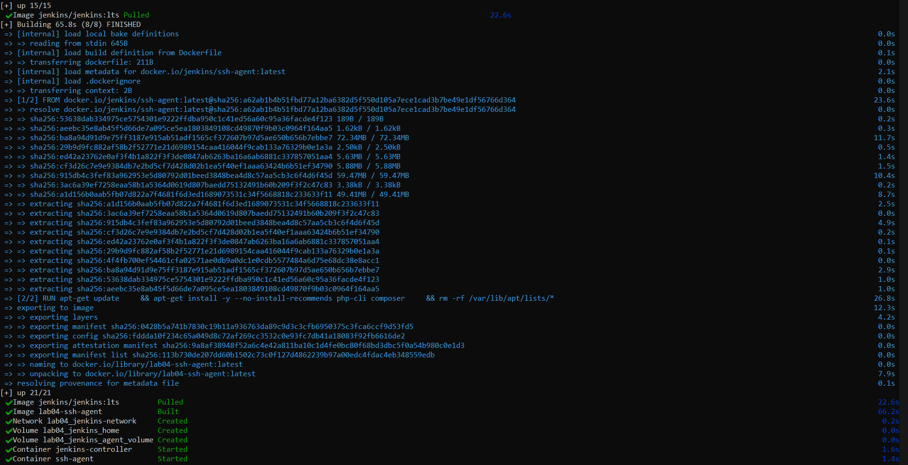
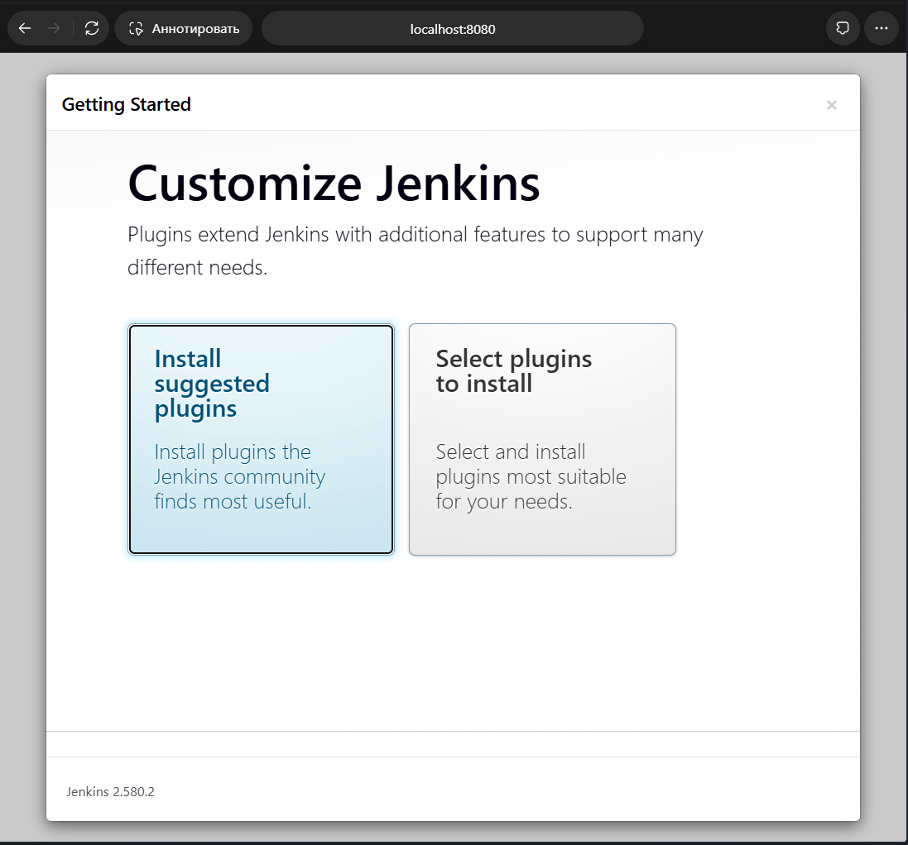
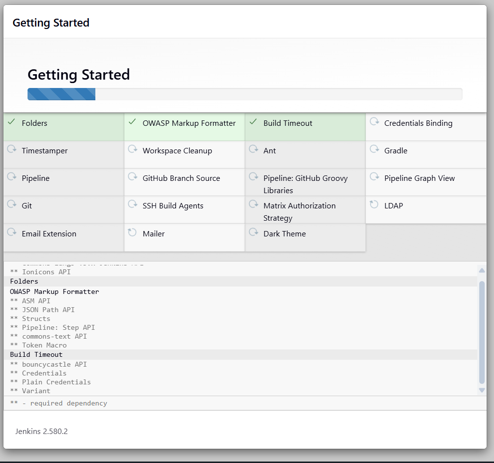
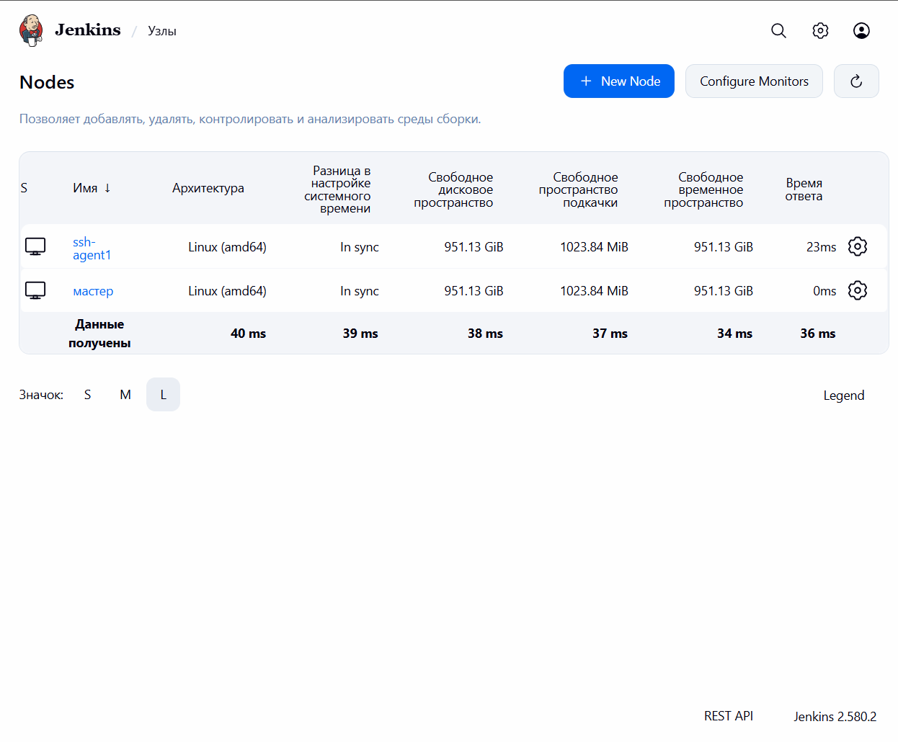
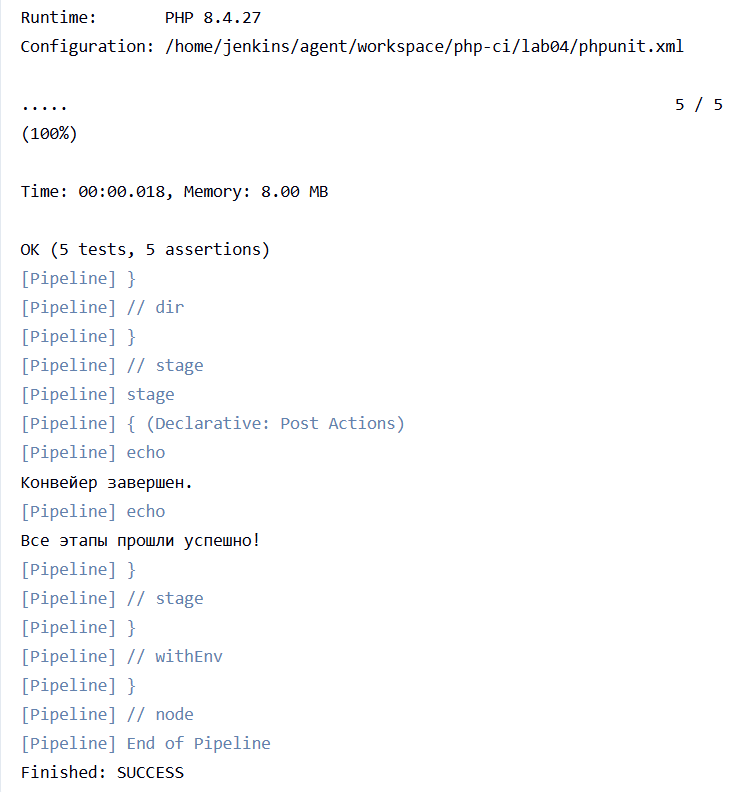

# IW04: Настройка Jenkins для автоматизации задач DevOps

## 1. Описание проекта

Для демонстрации CI создан учебный PHP-проект «Калькулятор». Класс `src/Calculator.php` реализует сложение, вычитание, умножение и деление. В `tests/CalculatorTest.php` находятся пять модульных тестов PHPUnit, включая проверку деления на ноль. Зависимости и тестовая команда описаны в `composer.json`, настройки PHPUnit — в `phpunit.xml`.

Jenkins Controller и SSH-агент запускаются с помощью Docker Compose. На агенте установлены PHP CLI, Composer и расширения PHP, необходимые PHPUnit. Pipeline хранится в `Jenkinsfile` и запускается на узле с меткой `php-agent`.

**Результат:** PHPUnit 10 выполнил 5 тестов и 5 assertions на PHP 8.4.27; сборка завершилась успешно (`Finished: SUCCESS`).

## 2. Настройка Jenkins Controller

1. Установить Docker Desktop и проверить, что Docker Engine запущен.
2. Из каталога `lab04` выполнить `docker compose up -d --build`.
3. Открыть `http://localhost:8080`, получить начальный пароль командой `docker exec jenkins-controller cat /var/jenkins_home/secrets/initialAdminPassword`, завершить мастер настройки и создать администратора Jenkins.
4. Установить рекомендуемые плагины и **SSH Build Agents**.

## 3. Настройка SSH-агента

1. Создать пару ключей для агента и локальный `.env` с публичным ключом в `JENKINS_AGENT_SSH_PUBKEY`. `.env` и `secrets/` исключены из Git; закрытый ключ хранится локально.
2. Запустить оба сервиса командой `docker compose up -d --build` и проверить их состояние через `docker compose ps`.
3. В Jenkins добавить Credentials типа **SSH Username with private key**. Пользователь — `jenkins`, приватный ключ должен соответствовать публичному ключу, переданному контейнеру агента.
4. Создать постоянный узел `ssh-agent1`: Remote root directory `/home/jenkins/agent`, метка `php-agent`, способ запуска **Launch agents via SSH**, Host `ssh-agent`, созданные Credentials. Подтвердить host key агента и проверить статус **Online**.

## 4. Создание и настройка Pipeline

Создать задание **Pipeline**, выбрать **Pipeline script from SCM**, указать Git-репозиторий `https://github.com/evesem/automation.git`, ветку `*/main` и путь скрипта `lab04/Jenkinsfile`. Pipeline устанавливает зависимости Composer в `lab04` и запускает `composer test --no-interaction` на узле с меткой `php-agent`.

Выполненная сборка завершилась успешно: установлены зависимости PHPUnit, все пять тестов прошли.

## 5. Ответы на вопросы

### Преимущества Jenkins для автоматизации DevOps

Jenkins автоматически запускает сборку и тесты при изменении кода, помогает раньше обнаруживать ошибки, интегрируется с Git и большим количеством инструментов через плагины. Pipeline as Code позволяет хранить настройки конвейера рядом с проектом, а агенты распределяют выполнение задач между разными средами.

### Какие ещё бывают агенты Jenkins?

Помимо SSH-агентов, применяются inbound-агенты, которые сами подключаются к контроллеру, а также временные агенты, создаваемые по требованию. Средой агента могут быть физическая или виртуальная машина, Docker-контейнер или Kubernetes-под.

## 6. Скриншоты выполнения

### Запуск Docker Compose

### Первоначальная настройка Jenkins и установка плагинов

### Подключённый агент

### Успешный запуск модульных тестов

